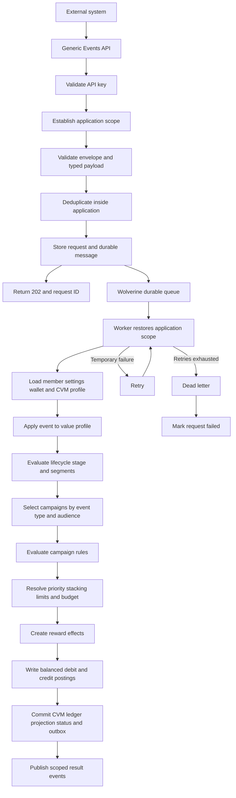

# Loyalty Platform MVP Implementation Plan

## 1. Purpose

Build a production-grade but functionally small loyalty platform that can grow without a rewrite.

The MVP proves this generic flow:

```text
Receive any supported loyalty event
→ authenticate the calling account
→ establish application scope
→ validate, deduplicate, and persist the event
→ return 202 Accepted with a request ID
→ process asynchronously
→ update the customer value profile idempotently
→ evaluate lifecycle stage and rule-based segments
→ select campaigns triggered by the event type
→ evaluate rules, limits, budgets, and stacking
→ apply reward effects as balanced debit and credit postings
→ publish result events
→ expose processing status
```

The system is not purchase-specific. Purchases are one of several supported event types.

## 2. MVP Success Criteria

- Manage a hierarchy of applications.
- Manage multiple accounts and rotatable API keys per application.
- Restrict every business query and write by application scope.
- Accept several loyalty-event types through one API.
- Return quickly with `202 Accepted` and process work in the background.
- Select campaigns by event type and evaluate configurable rules.
- Maintain an application-scoped customer value profile from dynamic events.
- Classify members into simple lifecycle stages and rule-based segments.
- Allow campaigns to target lifecycle stages and segments with an auditable profile snapshot.
- Award, reverse, or adjust points through an immutable standard double-entry ledger.
- Prevent duplicates during HTTP retries, message retries, and restarts.
- Expose request status and wallet balance/history.
- Preserve contracts and boundaries for future Kafka and module extraction.

## 3. Architecture and Stack

Start as a modular monolith:

```text
LoyaltyPlatform
├── Loyalty.Api
├── Loyalty.Worker
├── Loyalty.Core
│   ├── BuildingBlocks
│   ├── Contracts
│   └── Modules
└── Loyalty.Tests
```

Technology stack:

```text
.NET 10
ASP.NET Core
WolverineFx
PostgreSQL
EF Core and Npgsql
Microsoft RulesEngine
Scalar and OpenAPI
FluentValidation
Serilog
OpenTelemetry
xUnit, Alba, and Testcontainers
```

Use Wolverine durable PostgreSQL messaging for the MVP. Keep integration contracts transport-neutral so Kafka can later replace or supplement local transport without changing application handlers.

MVP modules:

```text
Applications
Accounts
Integrations
Members
CustomerValue
Campaigns
Rules
Wallets
```

Future modules:

```text
Tiers
Rewards
Redemptions
Achievements
Referrals
Notifications
Fraud
Reporting
Webhooks
Journeys
PredictiveModels
```

Each module uses:

```text
Module
├── Domain
├── Application
│   ├── Abstractions
│   └── Features
├── Infrastructure
├── Contracts
└── Endpoints
```

Business operations are vertical slices. Domain code has no dependency on EF Core, Wolverine, Kafka, HTTP, Redis, or Microsoft RulesEngine.

## 4. Application Hierarchy

Every business entity belongs to exactly one application.

```text
Application
├── Id
├── Name
├── ParentId nullable
├── IsActive
├── CreatedAt
└── UpdatedAt
```

- The first application is the root and has no parent.
- Every subsequent application has one existing parent.
- One application can have many child applications.
- Prevent cycles, self-parenting, invalid parents, and duplicate sibling names.
- Deactivating an application prevents its accounts from authenticating.
- Application moves are deferred from the MVP.

Use a closure table:

```text
ApplicationClosure
├── AncestorApplicationId
├── DescendantApplicationId
└── Depth
```

Each application has a self-row with depth `0`. Creation writes all closure rows transactionally.

Visibility is:

```text
Authenticated application
+ all descendant applications
```

A child cannot see parent or sibling data. Root accounts can see the entire tree.

## 5. Accounts as API Credentials

An `Account` is the API credential identity. There is no separate `ApiCredential` entity.

```text
Application 1 ─── many Accounts
```

Every account row contains exactly one API-key credential:

```text
Account
├── Id
├── ApplicationId
├── AccountName
├── KeyPrefix
├── KeyHash
├── IsActive
├── CreatedAt
├── ExpiresAt nullable
├── RevokedAt nullable
├── LastUsedAt nullable
└── LastAuthenticatedAt nullable
```

Enforce `UNIQUE(ApplicationId, AccountName)` and a unique searchable `KeyPrefix`.

Security requirements:

- Remove the constant API key from `appsettings.json`.
- Generate at least 32 cryptographically random bytes.
- Return the complete key once during creation.
- Store only a searchable prefix and cryptographic hash.
- Compare hashes using constant-time comparison.
- Never log or trace raw keys.
- Each account has one current key. Rotating the key atomically replaces its prefix and hash, immediately invalidating the previous key.
- When an integration needs an overlap period, create a second account row, migrate the caller, and then deactivate the old account.
- Apply revocation on the next request.
- Reject inactive, revoked, or expired accounts.
- Reject credentials when the account, application, or an ancestor is inactive.

Authentication claims:

```text
account_id
account_name
application_id
authentication_type = api_key
```

Until Keycloak supplies roles and permissions, only root-application accounts can manage accounts. Keep this behind a replaceable `CredentialManagement` policy.

Bootstrap the root application and first account with a one-time deployment command. Generate and display the initial key once; never store it in configuration.

## 6. Mandatory Application Ownership

Every domain entity implements:

```csharp
public interface IApplicationScoped
{
    Guid ApplicationId { get; }
}
```

This includes:

```text
Account credential
ApplicationLoyaltySettings and Member
Wallet, PointsLedgerAccount, PointsLedgerTransaction, and PointsLedgerPosting
Campaign, CampaignVersion, Conditions, Effects, Limits, and Usage
Rule and RuleVersion
IngestionRequest, ReceivedEvent, and ProcessedEvent
RewardDecision and RewardEffect
IdempotencyRecord
ApplicationCvmSettings, MemberValueProfile, SegmentDefinition, SegmentVersion, and MemberSegmentMembership
Tier and TierHistory
Achievement and AchievementProgress
Reward and Redemption
Referral, Notification, WebhookSubscription, and AuditEntry
```

Inbox, outbox, scheduled-message, dead-letter, and request-status rows also carry `ApplicationId` for application-owned work.

Only technical platform metadata is unscoped:

```text
EF migration history
ApplicationClosure
System health records
Global technical configuration
```

No business row has a nullable `ApplicationId`. The value is immutable after creation.

## 7. EF Core Scope Enforcement

Introduce:

```csharp
public interface IApplicationContext
{
    Guid ApplicationId { get; }
    Guid AccountId { get; }
    bool IsEstablished { get; }
}
```

Apply an EF Core global query filter to every `IApplicationScoped` entity. The filter uses `ApplicationClosure` to permit the current application and its descendants.

- Default new rows to the authenticated application.
- A parent may create data for a descendant only when explicitly requested and inside its subtree.
- Reject parent, sibling, unrelated, and nonexistent application IDs.
- Reject scoped queries when context is missing.
- Restore scope from the durable message before background processing.
- Allow query-filter bypass only in a narrow authentication/system repository.
- Add architecture tests forbidding general `IgnoreQueryFilters`.
- Include `ApplicationId` and `AccountId` in audit records.

Add a narrowly scoped `IApplicationLoyaltySettingsResolver`. It may read only settings belonging to the current application and its ancestors by joining `ApplicationClosure` where `DescendantApplicationId` equals the authenticated application. It orders by `Depth` ascending and returns the first settings row. This resolver does not grant general access to parent business data.

Apply the same whole-row nearest-ancestor behavior through a separate `IApplicationCvmSettingsResolver`. The resolver may read ancestor CVM configuration only; it does not grant access to ancestor customer profiles, segment memberships, or other business data.

Use composite foreign keys containing `ApplicationId` where practical:

```text
Application.Id = ApplicationLoyaltySettings.ApplicationId
Application.Id = ApplicationCvmSettings.ApplicationId
Member.(ApplicationId, DefaultWalletId) = Wallet.(ApplicationId, Id)
Wallet.(ApplicationId, MemberId) = Member.(ApplicationId, Id)
Campaign.ApplicationId = Rule.ApplicationId
Wallet.ApplicationId = PointsLedgerAccount.ApplicationId
PointsLedgerTransaction.ApplicationId = PointsLedgerPosting.ApplicationId
PointsLedgerAccount.ApplicationId = PointsLedgerPosting.ApplicationId
Event.ApplicationId = IngestionRequest.ApplicationId
```

Every business uniqueness constraint includes `ApplicationId`.

## 8. Generic Event Ingestion

Public endpoints:

```http
POST /api/v1/events
GET  /api/v1/requests/{requestId}
```

Canonical envelope:

```csharp
public sealed record LoyaltyEventEnvelopeV1(
    Guid EventId,
    string EventType,
    int EventVersion,
    string SourceTransactionId,
    string CustomerId,
    DateTimeOffset OccurredAt,
    string CorrelationId,
    JsonElement Attributes);
```

Derive `ApplicationId`, `AccountId`, and `SourceSystem` from the authenticated account. Never trust those values from request JSON.

Persist:

```text
ApplicationId
AccountId
SourceSystem
EventId
EventType
EventVersion
SourceTransactionId
CustomerId
OccurredAt
CorrelationId
Payload
Status
```

Initial typed events:

```text
PurchaseCompletedV1
OrderRefundedV1
CustomerRegisteredV1
ApplicationLoginV1
ReferralCompletedV1
ManualAdjustmentRequestedV1
```

A code-owned event-definition registry recognizes event types and versions, selects validators, validates attributes, maps to typed events, and rejects unsupported contracts. Database-configurable schemas are deferred.

Request statuses:

```text
Accepted
Queued
Processing
Retrying
Completed
Rejected
Failed
DeadLettered
```

`Rejected` is a valid business result such as no eligible campaign. Return `202` only after the request and durable message commit. Return `503` when durable acceptance fails.

## 9. Idempotency

Idempotency is enforced at four independent boundaries. Do not rely only on Wolverine message deduplication.

### 9.1 HTTP request idempotency

Every write request requires:

```http
Idempotency-Key: caller-generated-stable-value
```

Persist an `IdempotencyRecord` containing:

```text
ApplicationId
AccountId
OperationName
IdempotencyKey
RequestPayloadHash
RequestId
ResponseStatusCode
ResponseBody
CreatedAt
ExpiresAt
```

Enforce:

```text
UNIQUE(ApplicationId, AccountId, OperationName, IdempotencyKey)
```

Behavior:

- First request: atomically create the idempotency record, ingestion request, and durable Wolverine message.
- Same key and same payload hash: return the original `requestId` and original HTTP status without creating new work; the body may report the existing request's current processing status.
- Same key with a different payload hash: return `409 Conflict` with code `IDEMPOTENCY_KEY_REUSED`.
- Concurrent requests using the same key are resolved by the database unique constraint; the loser reads and returns the committed result.
- Keep records for a configurable retention period that is longer than the maximum caller retry window; default to 30 days for event ingestion.

### 9.2 Source-event identity

Protect exact event redelivery with:

```text
UNIQUE(ApplicationId, SourceSystem, EventId)
```

`EventVersion` describes the contract schema and must not make an already processed business event eligible for another reward.

### 9.3 Business-event identity

Define a deterministic business key per event type instead of using one universal `SourceTransactionId` rule:

```text
PurchaseCompleted  → SourceSystem + OrderId
OrderRefunded      → SourceSystem + RefundId
CustomerRegistered → SourceSystem + ExternalCustomerId
ApplicationLogin   → SourceSystem + CustomerId + RewardDate
ReferralCompleted  → SourceSystem + ReferralId
ManualAdjustment   → SourceSystem + AdjustmentId
```

Normalize this as `BusinessEventKey` and enforce:

```text
UNIQUE(ApplicationId, EventType, BusinessEventKey)
```

Rules:

- Different applications may reuse the same external identifiers.
- Partial refunds require a distinct `RefundId` and reference the original earning transaction.
- Repeated login events may be stored for audit, but the daily-login reward uses a key containing the reward date.
- A corrected source event does not overwrite the original. It creates a new correction or reversal event with its own business identity and reference to the original.

### 9.4 Reward-effect and ledger identity

Each campaign evaluation emits deterministic `EffectId` values. Protect application of an effect with:

```text
UNIQUE(
    ApplicationId,
    MemberId,
    SourceEventId,
    CampaignId,
    CampaignVersion,
    EffectId
)
```

Protect ledger transaction creation independently with:

```text
UNIQUE(
    ApplicationId,
    WalletId,
    TransactionType,
    SourceSystem,
    BusinessEventKey,
    EffectId
)
```

Store this uniqueness constraint on `PointsLedgerTransaction`, not on individual postings. One logical reward effect creates one ledger transaction containing two or more balanced postings.

The processed-message marker, campaign usage update, ledger transaction and postings, wallet balance projection, request status, and outgoing outbox event must commit in one PostgreSQL transaction. If the transaction rolls back, the message may be retried safely.

### 9.5 Duplicate results and operations

- API duplicates return the original `requestId` and current status.
- Message duplicates return the previously committed result without changing balances, budgets, or usage counters.
- Duplicate attempts are logged as structured audit events without logging sensitive payloads.
- Cleanup jobs archive expired HTTP idempotency responses but never delete immutable ledger transactions, postings, or the business identifiers required for financial deduplication.

## 10. Application Loyalty Settings and Members

`Application` represents the tenant, brand, service hierarchy, and security boundary. It does not contain reward-calculation configuration directly.

Use optional one-to-one settings:

```text
Application 1 ─── zero or one ApplicationLoyaltySettings
```

```text
ApplicationLoyaltySettings
├── ApplicationId primary key
├── Version
├── PointsUnitCode
├── BaseCurrency
├── SpendAmountPerPoint
├── RoundingPolicy
├── LoyaltyStatus
├── LoyaltyStartsAtUtc nullable
├── LoyaltyEndsAtUtc nullable
├── CreatedAt
└── UpdatedAt
```

Purpose:

- `PointsUnitCode` identifies the reward unit, such as `POINT`, `STAR`, or `MILE`.
- `BaseCurrency` identifies the purchase currency accepted by the default earning formula.
- `SpendAmountPerPoint` defines how much base-currency spend earns one base point.
- `RoundingPolicy` makes fractional-point calculation deterministic. The MVP supports `Floor` only.
- `LoyaltyStatus` controls reward processing independently from `Application.IsActive` and supports `Draft`, `Active`, `Paused`, and `Closed`.
- `LoyaltyStartsAtUtc` and `LoyaltyEndsAtUtc` optionally bound eligibility using the event's `OccurredAt` timestamp.

Default purchase calculation:

```text
floor(event amount / SpendAmountPerPoint)
```

Use `decimal` for money and `long` for points.

Hierarchy behavior:

- An organizational parent, such as a brand, may have no loyalty settings.
- Settings use all-or-nothing nearest-ancestor inheritance.
- If the current application has a settings row, use that complete row.
- If it has no settings row, walk upward and use the closest ancestor that has settings.
- Do not merge individual fields from multiple levels; a child row is a complete override.
- Parent settings therefore act as defaults for descendants that do not define their own settings.
- Missing settings on the application and every ancestor cause `LOYALTY_NOT_CONFIGURED`.
- Inactive or out-of-date settings cause `LOYALTY_NOT_ACTIVE`.
- Accounts belonging to an operational application process events with its resolved effective settings.
- Persist `ResolvedSettingsApplicationId`, `SettingsVersion`, and an immutable settings snapshot with the ingestion request and reward decision so audits show which application supplied the configuration.
- Freeze the resolved settings snapshot when the event is durably accepted; retries use the same values even if parent settings later change.
- Use the effective `PointsUnitCode` when provisioning application-local clearing accounts and a wallet's active, pending, and reserved ledger accounts.
- After an application or an inheriting descendant has ledger postings, reject a parent or child settings change that would alter its effective `PointsUnitCode` with `POINTS_UNIT_IN_USE`. Changing units requires a separately planned migration or a new wallet type.
- Other settings changes create a new settings version and affect only events accepted after that version becomes effective.
- Parent accounts are used for administration and reporting, not for submitting child-application events in the MVP.

```text
Member
├── Id
├── ApplicationId
├── ExternalCustomerId
├── DefaultWalletId
├── Status
├── CreatedAt
└── UpdatedAt
```

Enforce `UNIQUE(ApplicationId, ExternalCustomerId)`.

Every member must have exactly one default wallet. Generate the member ID and wallet ID in the application, then insert both rows in the same transaction. Use application-scoped composite foreign keys and PostgreSQL deferrable constraints so neither a member without its default wallet nor a wallet linked to another application's member can commit.

Do not add another points-balance column directly to `Member`. The member's balance is physically stored in its mandatory default `Wallet` row and returned in member read models. This avoids two balance copies becoming inconsistent and keeps the model ready for additional wallet types.

## 11. Customer Value Management Foundation

The MVP includes historical and rule-based Customer Value Management. It does not claim to calculate predictive customer lifetime value or use machine learning.

### 11.1 Application CVM settings

Use optional application-scoped configuration with the same whole-row nearest-ancestor fallback as loyalty settings:

```text
ApplicationCvmSettings
├── ApplicationId primary key
├── Version
├── CvmStatus
├── NewPeriodDays
├── AtRiskAfterDays
├── DormantAfterDays
├── ChurnedAfterDays
├── HighValueNetSpendThreshold
├── FrequentPurchaseThreshold
├── EvaluationWindowDays
├── CreatedAt
└── UpdatedAt
```

Initial defaults for the root example are:

```text
NewPeriodDays = 30
AtRiskAfterDays = 30
DormantAfterDays = 90
ChurnedAfterDays = 180
HighValueNetSpendThreshold = 1,000,000 IQD
FrequentPurchaseThreshold = 5
EvaluationWindowDays = 365
```

Require positive windows and this ordering:

```text
NewPeriodDays <= AtRiskAfterDays < DormantAfterDays < ChurnedAfterDays
```

A child row is a complete override; fields are never merged from different ancestors. Missing or paused CVM settings do not reject a valid loyalty event. They disable lifecycle and segment evaluation for that application while the core loyalty pipeline continues. A campaign that references CVM fields cannot be activated unless effective CVM settings exist and are active.

Interpret `HighValueNetSpendThreshold` in the effective loyalty `BaseCurrency`. Activation of monetary-value segments requires an active effective loyalty configuration with that currency.

Persist `ResolvedCvmSettingsApplicationId`, `CvmSettingsVersion`, and the effective CVM settings snapshot with any reward decision that uses CVM eligibility.

### 11.2 Member value profile

Create exactly one profile for every member:

```text
MemberValueProfile
├── ApplicationId
├── MemberId
├── FirstActivityAt nullable
├── LastActivityAt nullable
├── LastPurchaseAt nullable
├── PurchaseCount
├── NetSpendAmount
├── BaseCurrency
├── LoginCount
├── ReferralCount
├── PointsEarned
├── PointsRedeemed
├── PointsExpired
├── LifecycleStage
├── LastLifecycleEvaluationAt nullable
├── Version
├── CreatedAt
└── UpdatedAt
```

Enforce `UNIQUE(ApplicationId, MemberId)`. The value profile is a stored, application-scoped projection built from accepted typed events and committed ledger transactions. Original events and balanced ledger postings remain the sources of truth.

Member creation creates the initial profile in the same transaction and initializes first and last activity to the captured creation timestamp. A later `CustomerRegisteredV1` may fill missing historical values or move `FirstActivityAt` earlier, but never moves it later or increments the profile twice.

Use `decimal` for monetary totals and `long` for counts and points. `NetSpendAmount` is historical net spend in `BaseCurrency`; it is not predicted lifetime value. Foreign-exchange conversion and multi-currency value aggregation are deferred. Purchase events in a different currency cannot update this field unless they are normalized upstream to the effective base currency.

Profile updates from accepted events and committed ledger facts:

| Source fact | Profile changes |
|---|---|
| `CustomerRegisteredV1` | Fill missing registration activity or move first activity earlier |
| `ApplicationLoginV1` | Update last activity and login count |
| `PurchaseCompletedV1` | Update last activity, last purchase, purchase count, and net spend |
| `OrderRefundedV1` | Reduce net spend using the unique refund and original-order reference |
| `ReferralCompletedV1` | Update last activity and referral count |
| Committed `Earn` ledger transaction | Increase points earned in the same transaction |
| Committed `Redeem` ledger transaction | Increase points redeemed in the same transaction |
| Committed `Expire` ledger transaction | Increase points expired in the same transaction |

Use normalized event `OccurredAt`, not message receipt time, for customer activity. Apply `FirstActivityAt = min(existing, occurredAt)` and `LastActivityAt = max(existing, occurredAt)` so delayed delivery does not move activity backward.

Each external-event projector uses the existing processed-event mechanism with a distinct consumer name. Ledger-derived totals are updated by the ledger handler in its atomic transaction and are not applied again from the emitted result event. Re-delivery must not change a value profile twice.

### 11.3 Lifecycle stages

MVP lifecycle stages are:

```text
New
Active
AtRisk
Dormant
Churned
```

Evaluation is deterministic:

1. Calculate member age from `FirstActivityAt` and inactivity from `LastActivityAt` using one captured UTC evaluation timestamp.
2. A member whose age is within `NewPeriodDays` is `New`.
3. For older members, evaluate inactivity thresholds from highest to lowest: `Churned`, `Dormant`, then `AtRisk`.
4. An older member below the at-risk threshold is `Active`.

Evaluate after relevant member events and through a daily batched `EvaluateLifecycleStagesJob` for inactivity transitions. Use application scope, optimistic concurrency on `MemberValueProfile.Version`, idempotent batches, and a stable evaluation timestamp. Publish `MemberLifecycleChangedV1` only when the stage changes. No Saga is required.

### 11.4 Rule-based segments

```text
SegmentDefinition
├── Id
├── ApplicationId
├── Name
├── Status
├── CurrentVersion
├── CreatedAt
└── UpdatedAt
```

```text
SegmentVersion
├── ApplicationId
├── SegmentId
├── Version
├── Conditions
├── CreatedAt
└── CreatedByAccountId
```

```text
MemberSegmentMembership
├── Id
├── ApplicationId
├── MemberId
├── SegmentId
├── SegmentVersion
├── EnteredProfileVersion
├── LastEvaluatedProfileVersion
├── IsActive
├── EnteredAt
├── ExitedAt nullable
└── EvaluatedAt
```

Initial segment templates:

```text
NewCustomer
ActiveCustomer
AtRisk
Dormant
HighValue
FrequentCustomer
ReferralChampion
HighEngagement
```

Initial condition fields are limited to `LifecycleStage`, `PurchaseCount`, `NetSpendAmount`, `LoginCount`, `ReferralCount`, `PointsEarned`, `PointsRedeemed`, `PointsExpired`, `FirstActivityAt`, `LastActivityAt`, and `LastPurchaseAt`. Date comparisons receive the captured evaluation timestamp explicitly; expressions must not call the system clock.

Segment lifecycle:

```text
Draft → Validated → Activating → Active → Paused → Archived
                         └────→ ActivationFailed → Validated
```

Activation returns `202 Accepted` with the segment status URL. A scoped, idempotent background job evaluates existing profiles in bounded batches using one captured evaluation timestamp shared by every batch. The segment becomes `Active` only after the initial evaluation completes; campaigns cannot bind to a segment that is still activating.

Enforce `UNIQUE(ApplicationId, SegmentId, Version)` for versions. Segment conditions use a controlled field and operator registry, not arbitrary scripts. Use Microsoft RulesEngine only behind `ICvmSegmentEvaluator` for deterministic condition evaluation. The CVM domain owns definition versioning, membership transitions, and audit history. Published segment versions are immutable; editing creates a new version.

Allow only one active membership row per `(ApplicationId, MemberId, SegmentId)`. When a member leaves a segment, close the current membership with `ExitedAt`; do not erase history.

### 11.5 Campaign targeting and consistency

Extend `Campaign` with:

```text
RequiredLifecycleStages
RequiredSegmentIds
ExcludedSegmentIds
```

At campaign activation, resolve each segment ID to its active immutable `SegmentVersion` and store those versioned references in `CampaignVersion`. Later segment edits cannot change an already published campaign silently.

For the modular-monolith MVP, update the profile from the incoming event, evaluate lifecycle and relevant segments, and then evaluate CVM-targeted campaigns in the same application handler. Commit profile changes, membership changes, campaign usage, balanced ledger postings, wallet projections, request status, and outbox messages atomically.

Store `MemberValueProfile.Version`, lifecycle stage, and segment definition versions in `RewardDecision`. This makes a reward explainable even after the profile or segment rules change.

Use optimistic concurrency and retry the entire handler when two events update the same member. Do not silently overwrite profile, segment, campaign-usage, or wallet changes.

### 11.6 Privacy, explainability, and rebuilding

- Store customer identifiers and aggregates required for loyalty decisions; do not copy unnecessary personal data into the value profile.
- Audit CVM settings, segment-definition, and campaign-audience changes with application and account identity.
- Return matched fields, conditions, profile version, and segment versions from simulation and decision explanations.
- Do not use lifecycle or value segments for authentication, authorization, or access to essential account services.
- Outbound marketing must check the applicable consent policy when notification capabilities are added.
- Provide an administrative reconciliation operation that rebuilds a profile from accepted events and ledger facts, compares it with the stored projection, and reports differences before any controlled repair.

## 12. Campaigns and Rules

```text
Campaign
├── ApplicationId
├── TriggerEventType
├── MinimumEventVersion
├── Schedule
├── Conditions
├── Effects
├── Priority
├── StackingPolicy
├── MemberLimits
├── GlobalBudget
├── RequiredLifecycleStages
├── RequiredSegmentIds
├── ExcludedSegmentIds
├── Status
└── Version
```

Lifecycle:

```text
Draft → Validated → Active → Paused → Completed → Archived
```

Activation requires successful validation and simulation.

Initial operators:

```text
Equals
NotEquals
GreaterThan
GreaterThanOrEqual
LessThan
LessThanOrEqual
In
DateRange
```

MVP effects:

```text
AwardPoints
ReversePoints
AdjustPoints
NoReward
```

Prepare future effect contracts for tier progress, achievement progress, coupons, cashback, and notifications.

Use Microsoft RulesEngine only behind `ILoyaltyRuleEvaluator`. It evaluates conditions and returns a deterministic decision. It never writes balances, publishes messages, or calls external systems.

The loyalty domain owns campaign selection, priority, exclusivity, stacking, member limits, budgets, rounding, and typed effect creation.

Default stacking:

```text
One base calculation
+ stackable fixed bonuses
× highest eligible multiplier
```

An exclusive campaign suppresses lower-priority campaigns.

## 13. Wallet and Standard Double-Entry Ledger

```text
Wallet
├── Id
├── ApplicationId
├── MemberId
├── WalletType
├── PointsUnitCode
├── ActiveBalance
├── PendingBalance
├── ReservedBalance
└── Version
```

The MVP creates one mandatory default wallet for every member while retaining wallet type for future expansion. Enforce `UNIQUE(ApplicationId, MemberId, WalletType)` and require `Member.DefaultWalletId` to reference that member's default wallet.

`ActiveBalance`, `PendingBalance`, and `ReservedBalance` are real stored `long` columns, so normal member and wallet reads do not sum the entire ledger. They are fast projections, not the source of truth. Only the ledger posting service may update them, in the same transaction as balanced postings. A reconciliation operation recomputes them from member-account credits minus debits and reports any mismatch.

Use `Wallet.Version` as an optimistic concurrency token. A competing balance update must fail and retry the complete ledger transaction; it must never overwrite another committed balance. Prevent application code from updating balance columns outside the ledger persistence boundary through module visibility and architecture tests.

Do not model the ledger as one row containing only a signed amount. Use a standard double-entry header-and-posting model:

```text
PointsLedgerAccount
├── Id
├── ApplicationId
├── AccountCode
├── AccountType
├── WalletId nullable
├── BalanceBucket nullable
├── PointsUnitCode
├── NormalBalance
├── IsActive
├── CreatedAt
└── UpdatedAt
```

`PointsLedgerAccount` is an accounting account and is unrelated to the API-credential `Account` entity. Use the full name in code to avoid ambiguity.

Account types required by the model:

```text
MemberWallet
IssuanceClearing
RedemptionClearing
ExpirationClearing
AdjustmentClearing
```

Create separate credit-normal member accounts for the wallet's `Active`, `Pending`, and `Reserved` buckets. Internal clearing accounts have no `WalletId`.

```text
PointsLedgerTransaction
├── Id
├── ApplicationId
├── WalletId
├── TransactionType
├── PointsUnitCode
├── TotalDebit
├── TotalCredit
├── SourceEventId
├── SourceSystem
├── SourceTransactionId
├── BusinessEventKey
├── CorrelationId
├── CampaignId nullable
├── RuleId nullable
├── EffectId
├── ReversalOfTransactionId nullable
├── OccurredAt
└── CreatedAt
```

```text
PointsLedgerPosting
├── Id
├── ApplicationId
├── LedgerTransactionId
├── LedgerAccountId
├── Sequence
├── DebitAmount
├── CreditAmount
└── CreatedAt
```

Use `long` for point amounts. Every posting must satisfy:

```text
DebitAmount >= 0
CreditAmount >= 0
exactly one of DebitAmount or CreditAmount is greater than zero
```

Every completed ledger transaction must satisfy:

```text
at least two postings
all postings have the same ApplicationId and PointsUnitCode as the header
sum(DebitAmount) = sum(CreditAmount)
sum(DebitAmount) > 0
TotalDebit = posting debit sum
TotalCredit = posting credit sum
```

Enforce balancing in the domain service and again in PostgreSQL with constraints plus a deferred constraint trigger. A transaction is never visible in an unbalanced state because its header, postings, wallet projection, and outbox message commit atomically.

Standard posting examples:

| Operation | Debit | Credit | Wallet effect |
|---|---|---|---|
| Earn 10 active points | Issuance clearing `10` | Member active account `10` | Active `+10` |
| Reverse that earn | Member active account `10` | Issuance clearing `10` | Active `-10` |
| Positive adjustment | Adjustment clearing `10` | Member active account `10` | Active `+10` |
| Negative adjustment | Member active account `10` | Adjustment clearing `10` | Active `-10` |
| Reserve points | Member active account `10` | Member reserved account `10` | Active `-10`, reserved `+10` |
| Release reservation | Member reserved account `10` | Member active account `10` | Reserved `-10`, active `+10` |
| Redeem reserved points | Member reserved account `10` | Redemption clearing `10` | Reserved `-10` |
| Expire active points | Member active account `10` | Expiration clearing `10` | Active `-10` |

For credit-normal member accounts, calculate each bucket projection as:

```text
Member account balance = total credits - total debits
```

Prepare transaction types `Earn`, `Reverse`, `Adjust`, `Reserve`, `Release`, `Redeem`, and `Expire`; implement `Earn`, `Reverse`, and `Adjust` in the MVP.

Ledger transactions and postings are immutable. Corrections and refunds create new balanced compensating transactions whose `ReversalOfTransactionId` references the original transaction. Never update or delete the original postings.

## 14. Processing Flow



Every durable message carries:

```text
ApplicationId
AccountId
EventId
CorrelationId
CausationId
OccurredAt
```

Reject application-owned messages without a valid `ApplicationId`.

## 15. Clean End-to-End MVP Example

This example deliberately uses a non-purchase event. The same pipeline handles every event type registered in the event-definition registry.

### 15.1 Setup

Application hierarchy:

```text
Alwatani (root application)
├── Internet
└── Electricity
```

Configuration:

- `Alwatani` has active loyalty settings: `PointsUnitCode = POINT` and `Version = 3`.
- `Alwatani` has active CVM settings version `1` with the default lifecycle thresholds.
- `Internet` has no loyalty or CVM settings rows, so it inherits both complete rows from `Alwatani`.
- `Electricity` has its own settings override and is not involved in this request.
- Accounts `internet-mobile-api` and `internet-operations-api` belong to `Internet`; each account row has one independently managed API key.
- Member `customer-100`, its value profile, and its default wallet belong to `Internet`.
- Segment `New Customer` identifies profiles whose lifecycle stage is `New`.
- Campaign `Daily Mobile Login` belongs to `Internet`, triggers on `ApplicationLoginV1`, requires `Attributes.Channel = mobile` and segment `New Customer`, and awards `10` points once per member per calendar day.

The caller must not send an `ApplicationId`, `AccountId`, or `SourceSystem`. The API derives them from the authenticated account.

The IDs below are fixed only to make the example easy to follow:

| Name | ID |
|---|---|
| Alwatani | `10000000-0000-0000-0000-000000000001` |
| Internet | `10000000-0000-0000-0000-000000000002` |
| Electricity | `10000000-0000-0000-0000-000000000003` |
| Internet member | `20000000-0000-0000-0000-000000000001` |
| Internet wallet | `30000000-0000-0000-0000-000000000001` |
| Daily-login campaign | `40000000-0000-0000-0000-000000000001` |
| New-customer segment | `60000000-0000-0000-0000-000000000001` |

### 15.2 Create the application hierarchy

Assume the one-time bootstrap command has already created `Alwatani` and returned its root management API key once.

Create `Internet`:

```http
POST /api/v1/applications
X-API-Key: <alwatani-root-management-key>
Idempotency-Key: create-application-internet
Content-Type: application/json
```

```json
{
  "name": "Internet",
  "parentId": "10000000-0000-0000-0000-000000000001"
}
```

Example creation response:

```json
{
  "id": "10000000-0000-0000-0000-000000000002",
  "name": "Internet",
  "parentId": "10000000-0000-0000-0000-000000000001",
  "isActive": true
}
```

Create `Electricity` the same way with ID `10000000-0000-0000-0000-000000000003`. Application creation must insert the application and all closure-table rows in one transaction. The resulting closure rows are:

| Ancestor | Descendant | Depth |
|---|---|---:|
| Alwatani | Alwatani | 0 |
| Alwatani | Internet | 1 |
| Alwatani | Electricity | 1 |
| Internet | Internet | 0 |
| Electricity | Electricity | 0 |

### 15.3 Configure parent defaults and verify inheritance

Store one complete settings row on `Alwatani`:

```http
PUT /api/v1/applications/10000000-0000-0000-0000-000000000001/loyalty-settings
X-API-Key: <alwatani-root-management-key>
Idempotency-Key: alwatani-loyalty-settings-v3
Content-Type: application/json
```

```json
{
  "pointsUnitCode": "POINT",
  "baseCurrency": "IQD",
  "spendAmountPerPoint": 1000,
  "roundingPolicy": "Floor",
  "loyaltyStatus": "Active",
  "loyaltyStartsAtUtc": "2026-01-01T00:00:00Z",
  "loyaltyEndsAtUtc": null
}
```

The server returns `version = 3`. Do not create an `ApplicationLoyaltySettings` row for `Internet`.

An authenticated `Internet` account later receives this effective response:

```json
{
  "applicationId": "10000000-0000-0000-0000-000000000002",
  "sourceApplicationId": "10000000-0000-0000-0000-000000000001",
  "settingsVersion": 3,
  "isInherited": true,
  "pointsUnitCode": "POINT",
  "baseCurrency": "IQD",
  "spendAmountPerPoint": 1000,
  "roundingPolicy": "Floor",
  "loyaltyStatus": "Active"
}
```

Store root CVM defaults:

```http
PUT /api/v1/applications/10000000-0000-0000-0000-000000000001/cvm-settings
X-API-Key: <alwatani-root-management-key>
Idempotency-Key: alwatani-cvm-settings-v1
Content-Type: application/json
```

```json
{
  "cvmStatus": "Active",
  "newPeriodDays": 30,
  "atRiskAfterDays": 30,
  "dormantAfterDays": 90,
  "churnedAfterDays": 180,
  "highValueNetSpendThreshold": 1000000,
  "frequentPurchaseThreshold": 5,
  "evaluationWindowDays": 365
}
```

The server returns CVM settings version `1`. `Internet` has no CVM settings row, so its effective response contains `sourceApplicationId = Alwatani`, `settingsVersion = 1`, and `isInherited = true`.

If `Internet` later receives its own complete loyalty or CVM settings row, that row replaces the corresponding parent row as a whole. Deleting a child override restores fallback to `Alwatani`.

### 15.4 Create child credentials

The root management account creates an event-ingestion credential for `Internet`:

```http
POST /api/v1/applications/10000000-0000-0000-0000-000000000002/accounts
X-API-Key: <alwatani-root-management-key>
Idempotency-Key: create-internet-mobile-api
Content-Type: application/json
```

```json
{
  "accountName": "internet-mobile-api",
  "expiresAt": "2027-08-06T00:00:00Z"
}
```

Example creation response:

```json
{
  "accountId": "50000000-0000-0000-0000-000000000001",
  "applicationId": "10000000-0000-0000-0000-000000000002",
  "accountName": "internet-mobile-api",
  "apiKey": "lk_live_example-returned-once-only",
  "keyPrefix": "lk_live_exa",
  "isActive": true
}
```

The raw `apiKey` appears only in this response. The database stores `KeyPrefix` and `KeyHash`, never the raw value. Use a second account row for management or key-rotation overlap instead of storing multiple keys in one account.

Repeat the account-creation request with `accountName = internet-operations-api`. Use that separately returned key for member and campaign administration in this example. Both rows belong to `Internet`; each row is one credential and can be deactivated or rotated independently.

### 15.5 Create the member, wallet, and value profile

```http
POST /api/v1/members
X-API-Key: <internet-operations-api-key>
Idempotency-Key: create-member-customer-100
Content-Type: application/json
```

```json
{
  "externalCustomerId": "customer-100"
}
```

The handler derives `ApplicationId = Internet` and atomically creates the member, initial `MemberValueProfile`, wallet, three credit-normal member ledger accounts for `Active`, `Pending`, and `Reserved`, and any missing application-local clearing accounts for unit `POINT`. The API returns the member, value profile, and wallet view:

```json
{
  "memberId": "20000000-0000-0000-0000-000000000001",
  "applicationId": "10000000-0000-0000-0000-000000000002",
  "externalCustomerId": "customer-100",
  "defaultWalletId": "30000000-0000-0000-0000-000000000001",
  "status": "Active",
  "valueProfile": {
    "lifecycleStage": "New",
    "firstActivityAt": "2026-08-06T08:00:00Z",
    "lastActivityAt": "2026-08-06T08:00:00Z",
    "purchaseCount": 0,
    "netSpendAmount": 0,
    "baseCurrency": "IQD",
    "loginCount": 0,
    "referralCount": 0,
    "pointsEarned": 0,
    "pointsRedeemed": 0,
    "pointsExpired": 0,
    "version": 1
  },
  "wallet": {
    "walletId": "30000000-0000-0000-0000-000000000001",
    "walletType": "Default",
    "activeBalance": 0,
    "pendingBalance": 0,
    "reservedBalance": 0
  }
}
```

### 15.6 Create the segment and campaign

Create a rule-based segment owned by `Internet`:

```http
POST /api/v1/segments
X-API-Key: <internet-operations-api-key>
Idempotency-Key: create-new-customer-segment
Content-Type: application/json
```

```json
{
  "name": "New Customer",
  "conditions": [
    {
      "field": "lifecycleStage",
      "operator": "Equals",
      "value": "New"
    }
  ]
}
```

The response assigns segment ID `60000000-0000-0000-0000-000000000001` and status `Draft`. Validate and activate it:

```http
POST /api/v1/segments/60000000-0000-0000-0000-000000000001/validate
X-API-Key: <internet-operations-api-key>
Idempotency-Key: validate-new-customer-segment-v1

POST /api/v1/segments/60000000-0000-0000-0000-000000000001/activate
X-API-Key: <internet-operations-api-key>
Idempotency-Key: activate-new-customer-segment-v1
```

Activation returns `202 Accepted`. After the scoped background evaluation completes, the segment becomes `Active`; `customer-100` enters `New Customer` with segment version `1` and profile version `1`. Wait for that status before activating the campaign.

Create the targeted campaign:

```http
POST /api/v1/campaigns
X-API-Key: <internet-operations-api-key>
Idempotency-Key: create-daily-mobile-login-campaign
Content-Type: application/json
```

```json
{
  "name": "Daily Mobile Login",
  "triggerEventType": "ApplicationLogin",
  "minimumEventVersion": 1,
  "startsAtUtc": "2026-08-01T00:00:00Z",
  "endsAtUtc": null,
  "priority": 100,
  "stackingPolicy": "Stackable",
  "requiredLifecycleStages": ["New"],
  "requiredSegmentIds": [
    "60000000-0000-0000-0000-000000000001"
  ],
  "excludedSegmentIds": [],
  "conditions": [
    {
      "field": "attributes.channel",
      "operator": "Equals",
      "value": "mobile"
    }
  ],
  "effects": [
    {
      "effectId": "daily-mobile-login-10-points",
      "type": "AwardPoints",
      "points": 10
    }
  ],
  "memberLimits": [
    {
      "period": "CalendarDay",
      "maximumExecutions": 1
    }
  ],
  "globalBudget": null
}
```

The creation response assigns campaign ID `40000000-0000-0000-0000-000000000001` and status `Draft`.

The API derives `ApplicationId = Internet`. It must not accept an application ID in this request.

```http
POST /api/v1/campaigns/40000000-0000-0000-0000-000000000001/validate
X-API-Key: <internet-operations-api-key>
Idempotency-Key: validate-daily-mobile-login-v1

POST /api/v1/campaigns/40000000-0000-0000-0000-000000000001/simulate
X-API-Key: <internet-operations-api-key>
Idempotency-Key: simulate-daily-mobile-login-v1
Content-Type: application/json
```

```json
{
  "eventType": "ApplicationLogin",
  "eventVersion": 1,
  "customerId": "customer-100",
  "occurredAt": "2026-08-06T08:30:00Z",
  "attributes": {
    "channel": "mobile"
  }
}
```

Expected simulation result:

```json
{
  "eligible": true,
  "lifecycleStage": "New",
  "matchedSegments": [
    {
      "segmentId": "60000000-0000-0000-0000-000000000001",
      "name": "New Customer",
      "version": 1
    }
  ],
  "profileVersion": 1,
  "matchedConditions": ["attributes.channel Equals mobile"],
  "effects": [
    {
      "effectId": "daily-mobile-login-10-points",
      "type": "AwardPoints",
      "points": 10
    }
  ],
  "changesPersisted": false
}
```

Finally activate it:

```http
POST /api/v1/campaigns/40000000-0000-0000-0000-000000000001/activate
X-API-Key: <internet-operations-api-key>
Idempotency-Key: activate-daily-mobile-login-v1
```

### 15.7 Submit the event and receive the immediate response

```http
POST /api/v1/events
X-API-Key: <internet-mobile-api-key>
Idempotency-Key: internet-login-customer-100-2026-08-06
Content-Type: application/json
```

```json
{
  "eventId": "58e3225c-6a06-4cb8-b70b-80a467a3a38c",
  "eventType": "ApplicationLogin",
  "eventVersion": 1,
  "sourceTransactionId": "LOGIN-90001",
  "customerId": "customer-100",
  "occurredAt": "2026-08-06T08:30:00Z",
  "correlationId": "CORR-90001",
  "attributes": {
    "channel": "mobile",
    "deviceType": "android",
    "sessionId": "SESSION-70001"
  }
}
```

The API performs only the reliable acceptance path before responding:

1. Authenticate the API key and load account `internet-mobile-api`.
2. Reject the call if the account, `Internet`, or any ancestor is inactive.
3. Establish `ApplicationId = Internet` and the account identity.
4. Validate the `ApplicationLoginV1` envelope and attributes.
5. Resolve effective loyalty and CVM settings from `Alwatani` because `Internet` has no overrides.
6. Freeze loyalty settings source `Alwatani` version `3` and CVM settings source `Alwatani` version `1` with both effective snapshots.
7. In one PostgreSQL transaction, insert the idempotency record, ingestion request, and durable Wolverine message.
8. Return only after that transaction commits.

```http
HTTP/1.1 202 Accepted
Location: /api/v1/requests/REQ-10001
```

```json
{
  "requestId": "REQ-10001",
  "status": "Accepted",
  "statusUrl": "/api/v1/requests/REQ-10001"
}
```

`202 Accepted` means the event is stored safely. It does not mean the reward has already been applied.

### 15.8 Background processing

```mermaid
flowchart LR
    A["Internet mobile client"] --> B["Events API"]
    B --> C["Authenticate account"]
    C --> D["Set Internet scope"]
    D --> E["Store request and durable message"]
    E --> F["Return 202 with request ID"]
    E --> G["Wolverine worker"]
    G --> H["Restore Internet scope"]
    H --> I["Load inherited loyalty and CVM snapshots"]
    I --> J["Update member value profile"]
    J --> K["Evaluate New lifecycle and segment"]
    K --> L["Select targeted ApplicationLogin campaigns"]
    L --> M["Evaluate channel and daily limit"]
    M --> N["Create balanced 10 point postings"]
    N --> O["Commit CVM, postings, projections, usage, status, and outbox"]
```



The worker then:

1. Restores `Internet` application scope from the durable message.
2. Loads only the `Internet` member, value profile, segment memberships, campaigns, wallet, and usage rows allowed by that scope.
3. Uses the loyalty and CVM settings snapshots frozen at acceptance, even if `Alwatani` settings have since changed.
4. Applies the login event once: `LastActivityAt = 08:30`, `LoginCount = 1`, and profile version advances from `1` to `2`.
5. Keeps lifecycle stage `New`; the existing `New Customer` membership retains entered profile version `1` and records last-evaluated profile version `2`.
6. Builds the daily-login business key from the source system, customer, and reward date.
7. Matches the campaign audience, channel condition, and daily limit, then creates a deterministic reward effect.
8. Creates one `Earn` ledger transaction with a `10`-point debit to issuance clearing and a `10`-point credit to the member active account.
9. Verifies `TotalDebit = TotalCredit = 10`.
10. Commits the processed-message marker, profile, membership, campaign usage, ledger header, both postings, `+10` active-balance projection, `PointsAwardedV1` outbox event, and request status in one transaction.

Expected committed result:

| Data | Expected value |
|---|---|
| Request | `REQ-10001`, `Completed` |
| Effective loyalty settings | `Alwatani`, version `3`, inherited |
| Effective CVM settings | `Alwatani`, version `1`, inherited |
| Value profile | lifecycle `New`, login count `1`, profile version `2` |
| Segment membership | `New Customer`, segment version `1`, entered profile `1`, last evaluated profile `2` |
| Campaign usage | One daily execution for `customer-100` |
| Ledger transaction | `Earn`, total debit `10 POINT`, total credit `10 POINT` |
| Debit posting | Issuance clearing, debit `10 POINT` |
| Credit posting | Member active account, credit `10 POINT` |
| Wallet balance | Previous balance plus `10` |
| Result event | One `PointsAwardedV1` outbox message |

Status response:

```http
GET /api/v1/requests/REQ-10001
X-API-Key: <internet-mobile-api-key>
```

```json
{
  "requestId": "REQ-10001",
  "status": "Completed",
  "eventType": "ApplicationLogin",
  "customerId": "customer-100",
  "awardedPoints": 10,
  "pointsUnitCode": "POINT",
  "completedAt": "2026-08-06T08:30:02Z"
}
```

### 15.9 Verify the value profile, wallet, ledger, and persisted state

Read the CVM profile and active segments:

```http
GET /api/v1/members/20000000-0000-0000-0000-000000000001/value-profile
X-API-Key: <internet-mobile-api-key>
```

```json
{
  "memberId": "20000000-0000-0000-0000-000000000001",
  "lifecycleStage": "New",
  "firstActivityAt": "2026-08-06T08:00:00Z",
  "lastActivityAt": "2026-08-06T08:30:00Z",
  "lastPurchaseAt": null,
  "purchaseCount": 0,
  "netSpendAmount": 0,
  "baseCurrency": "IQD",
  "loginCount": 1,
  "referralCount": 0,
  "pointsEarned": 10,
  "pointsRedeemed": 0,
  "pointsExpired": 0,
  "profileVersion": 2,
  "activeSegments": [
    {
      "segmentId": "60000000-0000-0000-0000-000000000001",
      "name": "New Customer",
      "segmentVersion": 1
    }
  ]
}
```

Read the wallet with an `Internet` credential:

```http
GET /api/v1/members/20000000-0000-0000-0000-000000000001/wallet
X-API-Key: <internet-mobile-api-key>
```

```json
{
  "walletId": "30000000-0000-0000-0000-000000000001",
  "memberId": "20000000-0000-0000-0000-000000000001",
  "pointsUnitCode": "POINT",
  "activeBalance": 10,
  "pendingBalance": 0,
  "reservedBalance": 0,
  "version": 1
}
```

Read its immutable history:

```http
GET /api/v1/members/20000000-0000-0000-0000-000000000001/wallet/transactions
X-API-Key: <internet-mobile-api-key>
```

```json
{
  "items": [
    {
      "transactionId": "TX-10001",
      "transactionType": "Earn",
      "pointsUnitCode": "POINT",
      "totalDebit": 10,
      "totalCredit": 10,
      "postings": [
        {
          "sequence": 1,
          "ledgerAccountCode": "POINTS_ISSUANCE",
          "accountType": "IssuanceClearing",
          "debitAmount": 10,
          "creditAmount": 0
        },
        {
          "sequence": 2,
          "ledgerAccountCode": "WALLET-30000000-ACTIVE",
          "accountType": "MemberWallet",
          "balanceBucket": "Active",
          "debitAmount": 0,
          "creditAmount": 10
        }
      ],
      "walletDelta": {
        "active": 10,
        "pending": 0,
        "reserved": 0
      },
      "activeBalanceAfter": 10,
      "sourceEventId": "58e3225c-6a06-4cb8-b70b-80a467a3a38c",
      "sourceSystem": "internet-mobile-api",
      "sourceTransactionId": "LOGIN-90001",
      "campaignId": "40000000-0000-0000-0000-000000000001",
      "effectId": "daily-mobile-login-10-points",
      "occurredAt": "2026-08-06T08:30:00Z"
    }
  ]
}
```

The committed database state must be equivalent to:

| Table or aggregate | Important committed values |
|---|---|
| `integration.ingestion_requests` | `REQ-10001`, Internet application, event ID, `Completed`, loyalty source/version `Alwatani/3`, CVM source/version `Alwatani/1`, frozen settings JSON |
| `integration.processed_events` | Internet application, worker consumer name, event ID |
| `cvm.member_value_profiles` | Internet application, member ID, lifecycle `New`, login count `1`, points earned `10`, profile version `2` |
| `cvm.segment_definitions` | `New Customer`, active, current version `1` |
| `cvm.segment_versions` | Immutable version `1` condition `LifecycleStage Equals New` |
| `cvm.member_segment_memberships` | Active membership, entered with profile version `1`, last evaluated with profile version `2` |
| `campaigns.reward_decisions` | Campaign version, profile version `2`, lifecycle `New`, segment version `1`, and deterministic effect ID |
| `campaigns.campaign_usage` | Internet application, campaign ID, member ID, period `2026-08-06`, execution count `1`, issued points `10` |
| `wallets.points_ledger_accounts` | Issuance clearing plus the member's active, pending, and reserved credit-normal accounts |
| `wallets.points_ledger_transactions` | `TX-10001`, Internet application, `Earn`, total debit `10`, total credit `10`, deterministic effect ID and business key |
| `wallets.points_ledger_postings` | Exactly two rows: issuance debit `10` and member-active credit `10` |
| `wallets.wallets` | active balance `10`, version `1` |
| `messaging.outbox_messages` | one scoped `PointsAwardedV1` message awaiting or completing delivery |
| `integration.idempotency_records` | Internet application, mobile account, operation `SubmitEvent`, caller key, payload hash, `REQ-10001`, original `202` response |

No balance can be reconstructed from request status alone. The immutable balanced ledger postings are the source of truth; wallet balances are checked projections of the member accounts' credits minus debits.

### 15.10 Retry and duplicate behavior

The reward must remain exactly `10` points in every retry case:

- Same idempotency key and same payload: return `REQ-10001` and its current status; create no new work.
- Same idempotency key with a different payload: return `409 IDEMPOTENCY_KEY_REUSED`.
- New idempotency key with the same `EventId`: the source-event uniqueness constraint prevents another request from being processed.
- New `EventId` for the same member and login date: the daily-login business key and campaign limit prevent another reward.
- Worker crash before transaction commit: all changes roll back and Wolverine retries the message.
- Worker crash after transaction commit: inbox, CVM projector, effect, and ledger uniqueness make redelivery a no-op.
- Duplicate delivery does not increment login count, profile version, points totals, or segment history twice.
- Parent settings change after acceptance: retry still uses frozen loyalty version `3` and CVM version `1` snapshots.

For the same idempotency key and identical payload, return the stored acceptance response:

```json
{
  "requestId": "REQ-10001",
  "status": "Completed",
  "duplicate": true,
  "statusUrl": "/api/v1/requests/REQ-10001"
}
```

The response may expose the current request status, but it must preserve the original request ID and must not enqueue another message.

### 15.11 Scope behavior

- The `Internet` account can read `REQ-10001`, `customer-100`, its value profile, segment memberships, and wallet.
- A root `Alwatani` management account can read the result because `Internet` is a descendant.
- An `Electricity` account receives `404` for those identifiers so it cannot discover sibling data.
- A child account never receives general access to the parent row merely because its loyalty settings were inherited; only the settings resolver may read the nearest ancestor configuration.

### 15.12 Expected error behavior

| Condition | Result |
|---|---|
| Missing or invalid API key | `401 Unauthorized` |
| Inactive account, application, or ancestor | `403 Forbidden` |
| Unsupported event type or version | `400 Bad Request` |
| Invalid typed attributes | `422 Unprocessable Entity` |
| No settings on the application or any ancestor | `422 LOYALTY_NOT_CONFIGURED`; do not create durable work |
| Effective settings are paused, closed, or outside their active dates | `422 LOYALTY_NOT_ACTIVE`; do not create durable work |
| CVM settings are missing or paused and no campaign requires CVM | Continue loyalty processing and skip CVM classification |
| Campaign references CVM but effective CVM settings are unavailable | Campaign activation fails with `CVM_NOT_CONFIGURED` |
| No eligible campaign | Accepted request becomes `Rejected` with `NO_ELIGIBLE_CAMPAIGN` |
| Durable database acceptance fails | `503 Service Unavailable`; never return `202` |
| Transient worker failure | `Retrying`, followed by `Completed` or `DeadLettered` |

### 15.13 Apply the same pipeline to other event types

`POST /api/v1/events` does not change when a new event type is used. Only the registered typed attributes, business-key strategy, eligible campaigns, and effects change.

| Event type | Example required attributes | Example business identity | Possible effect |
|---|---|---|---|
| `ApplicationLoginV1` | `channel`, `sessionId` | source + customer + reward date | Award a daily fixed bonus |
| `CustomerRegisteredV1` | `registrationChannel` | source + external customer ID | Award welcome points |
| `ReferralCompletedV1` | `referralId`, `referrerCustomerId`, `refereeCustomerId` | source + referral ID | Award referrer and referee effects |
| `PurchaseCompletedV1` | `orderId`, `amount`, `currency`, `category` | source + order ID | Calculate base points and campaign bonuses |
| `OrderRefundedV1` | `refundId`, `originalOrderId`, `amount`, `currency` | source + refund ID | Create a compensating reversal |
| `ManualAdjustmentRequestedV1` | `adjustmentId`, `signedPoints`, `reason` | source + adjustment ID | Add a controlled adjustment entry |

For each added type, implement all of the following together:

1. A versioned typed contract.
2. Attribute validation and normalization.
3. Registry mapping from `EventType + EventVersion`.
4. A deterministic business-key builder.
5. Allowed campaign fields and typed effects.
6. Authorization requirements for sensitive types such as manual adjustments.
7. Unit, integration, idempotency, and end-to-end tests.

Do not add a separate controller, queue, or ledger table for every event type. They share the generic envelope and reliable pipeline while retaining type-specific validation and business identity.

### 15.14 Release-gate acceptance test

This complete scenario is the MVP release gate. The automated test must:

1. Create the application hierarchy and verify closure rows.
2. Configure only parent loyalty and CVM settings and prove both child fallbacks.
3. Create separate child operation and ingestion accounts.
4. Create the member, initial value profile, wallet, active segment, and targeted campaign.
5. Submit the login event and receive `202` only after durable commit.
6. Wait for `Completed`, assert profile version `2`, active `New Customer` membership, and one immutable `Earn` transaction containing issuance debit `10` and member-active credit `10`.
7. Exercise every HTTP, event, CVM projector, segment, business-key, effect, ledger, and worker retry duplicate path.
8. Change parent loyalty and CVM settings before a forced retry and prove accepted snapshots remain versions `3` and `1`.
9. Prove Internet and Alwatani visibility and Electricity isolation.
10. Prove invalid credentials, unsupported events, and durable acceptance failures return the documented results.

Run it through the real API, PostgreSQL, Wolverine durable messaging, rules adapter, and status API using Testcontainers rather than mocks.

## 16. Public APIs

Applications and credential accounts:

```http
POST  /api/v1/applications
GET   /api/v1/applications
GET   /api/v1/applications/{applicationId}
PATCH /api/v1/applications/{applicationId}/status

POST  /api/v1/applications/{applicationId}/accounts
GET   /api/v1/applications/{applicationId}/accounts
PATCH /api/v1/accounts/{accountId}/status
POST  /api/v1/accounts/{accountId}/rotate-key
POST  /api/v1/accounts/{accountId}/revoke
```

Creating an account returns its complete API key exactly once. Normal account reads return only `KeyPrefix` and lifecycle metadata. `rotate-key` returns the new complete key once and invalidates the previous key atomically.

Application settings and members:

```http
PUT  /api/v1/applications/{applicationId}/loyalty-settings
GET  /api/v1/applications/{applicationId}/loyalty-settings
DELETE /api/v1/applications/{applicationId}/loyalty-settings
PUT  /api/v1/applications/{applicationId}/cvm-settings
GET  /api/v1/applications/{applicationId}/cvm-settings
DELETE /api/v1/applications/{applicationId}/cvm-settings
POST /api/v1/members
GET  /api/v1/members/{memberId}
GET  /api/v1/members/by-external-id/{externalCustomerId}
```

- `PUT` creates or replaces the application's complete settings override.
- `GET` returns the effective settings plus `sourceApplicationId`, `settingsVersion`, and `isInherited`.
- `DELETE` removes the application's override so resolution falls back to the closest configured ancestor.
- Loyalty and CVM settings use independent versions and independent nearest-ancestor resolution.
- Member creation always creates the required default wallet in the same transaction.
- Member read responses include the stored default-wallet active, pending, and reserved balances; clients do not need a separate ledger aggregation query.

Customer value and segments:

```http
GET  /api/v1/members/{memberId}/value-profile
GET  /api/v1/members/{memberId}/segments

POST /api/v1/segments
PUT  /api/v1/segments/{segmentId}
POST /api/v1/segments/{segmentId}/validate
POST /api/v1/segments/{segmentId}/simulate
POST /api/v1/segments/{segmentId}/activate
POST /api/v1/segments/{segmentId}/pause
GET  /api/v1/segments
GET  /api/v1/segments/{segmentId}
GET  /api/v1/segments/{segmentId}/members
```

Profile reads return historical value metrics and current active segment memberships. Segment simulation is read-only and returns matching conditions without changing membership history.

`PUT` edits only a draft or creates a new draft version for an already published segment. Segment activation is asynchronous; callers poll `GET /api/v1/segments/{segmentId}` until it reaches `Active` or `ActivationFailed`.

Events and status:

```http
POST /api/v1/events
GET  /api/v1/requests/{requestId}
```

Wallets:

```http
GET /api/v1/members/{memberId}/wallet
GET /api/v1/members/{memberId}/wallet/transactions
```

The wallet transaction endpoint returns logical `PointsLedgerTransaction` records with their debit and credit postings. It does not expose or recreate the removed single-row signed-amount model.

Campaigns:

```http
POST /api/v1/campaigns
PUT  /api/v1/campaigns/{campaignId}
POST /api/v1/campaigns/{campaignId}/validate
POST /api/v1/campaigns/{campaignId}/simulate
POST /api/v1/campaigns/{campaignId}/activate
POST /api/v1/campaigns/{campaignId}/pause
GET  /api/v1/campaigns
GET  /api/v1/campaigns/{campaignId}
```

All endpoints automatically apply application-tree scope.

## 17. Persistence and Reliability

Use one PostgreSQL database with module schemas:

```text
applications.*
accounts.*
members.*
cvm.*
integration.*
campaigns.*
rules.*
wallets.*
messaging.*
```

A critical processing transaction updates request state, CVM profile and memberships, campaign usage/budget, balanced ledger header and postings, wallet projections, and outbox events atomically.

Operational requirements:

- Retry transient failures with bounded exponential backoff.
- Do not retry invalid or ineligible business events.
- Persist exhausted messages in dead-letter storage.
- Support controlled replay while retaining idempotency.
- Apply account/source rate limits and payload limits.
- Return `429` for rate limiting and `503` when work cannot be accepted.
- Add PostgreSQL and Wolverine health checks.
- Monitor profile concurrency retries, lifecycle-job lag, segment-activation progress, and CVM reconciliation mismatches.
- Log and trace `ApplicationId`, `AccountId`, `RequestId`, and `CorrelationId`.
- Never emit secrets or sensitive payloads to telemetry.

## 18. Implementation Order

1. Pin wildcard NuGet versions and validate configuration.
2. Implement application hierarchy and closure persistence.
3. Implement credential accounts, key hashing, rotation, revocation, and root bootstrap.
4. Implement application context, scoped entities, query filters, write validation, and audit scope.
5. Add architecture tests for ownership and filter bypass.
6. Implement ApplicationLoyaltySettings and ApplicationCvmSettings with independent inheritance and versioning.
7. Implement Members, their initial value profiles, mandatory default Wallets, stored balance projections, and the immutable standard double-entry ledger together.
8. Implement the canonical envelope and event registry.
9. Implement ingestion, request status, and idempotency.
10. Configure Wolverine durability and background scope restoration.
11. Implement MemberValueProfile updates, lifecycle evaluation, the daily inactivity job, segment definitions, memberships, and simulation.
12. Implement campaigns, CVM audience targeting, simulation, budgets, limits, and stacking.
13. Implement RulesEngine behind loyalty and CVM evaluator abstractions.
14. Implement purchase, refund, registration, login, referral, points-result, and adjustment cases.
15. Add retries, reconciliation, dead-letter operations, observability, and load tests.
16. Add Kafka only when streaming or independent consumers require it.

## 19. Test Plan

Application and credentials:

- Root has no parent.
- Closure rows are correct.
- Invalid hierarchies are rejected.
- Applications have many credential accounts; every account row has exactly one current API key.
- Raw keys are never stored or logged.
- Valid keys authenticate; invalid, expired, inactive, and revoked keys fail.
- Account/application deactivation immediately blocks access.
- Organizational applications may exist without loyalty settings.
- An application with explicit settings uses its own complete settings row.
- An application without settings inherits the closest configured ancestor's complete row.
- A child override does not merge individual fields with its parent.
- Removing a child override restores parent fallback.
- Resolution never crosses into a sibling or unrelated application.
- Processing fails when neither the application nor any ancestor has active settings.
- Accepted events retain the same effective settings snapshot across retries and parent-setting changes.
- Different child applications can use different point units, base currencies, and earn ratios.
- Changing an effective points unit is rejected after the application or an inheriting descendant has ledger postings.
- A non-unit settings change creates a new version and affects only subsequently accepted events.
- Pausing loyalty processing does not disable API authentication or historical balance queries.

Scope:

- Every business entity has a required `ApplicationId`.
- Root sees all descendants.
- Parent sees itself and descendants.
- Child cannot see parent or siblings.
- Reads, joins, counts, updates, and deletes do not leak data.
- Cross-application relationships are rejected.
- Spoofed application IDs are rejected.
- Background retries preserve the original scope.
- Unauthorized `IgnoreQueryFilters` use fails architecture tests.

Events and idempotency:

- Supported events map to typed contracts.
- Unknown types and versions are rejected before queueing.
- Same idempotency key and payload return the original request and response.
- Reusing an idempotency key with a different payload returns `409 Conflict`.
- Concurrent requests with the same key create one ingestion request.
- Different event IDs for one business event create one effect.
- Changing `EventVersion` does not award the same business event again.
- Event-specific business keys correctly handle purchases, partial refunds, daily logins, registrations, referrals, and adjustments.
- Different applications may reuse a source transaction ID.
- Worker restarts and retries never duplicate effects.
- A failure after balanced ledger insertion but before message acknowledgement is safely deduplicated on retry.
- Campaign budgets and usage counters are unchanged by duplicate effects.
- No matching campaign produces `Rejected`, not `Failed`.

CVM profiles and segments:

- Member creation atomically creates exactly one application-scoped value profile.
- Loyalty and CVM settings resolve and version independently.
- Child CVM overrides use a complete row and deletion restores nearest-parent fallback.
- Missing or paused CVM settings do not block campaigns that do not use CVM fields.
- Campaign activation rejects CVM targeting when effective CVM settings are unavailable.
- Login, purchase, refund, registration, and referral events plus committed earn, redeem, and expire ledger transactions update only their defined metrics.
- Duplicate events and worker retries do not increment profile metrics or create membership history twice.
- Delayed events use `OccurredAt`: they may move first activity earlier but never move last activity backward.
- Refund processing reduces net spend once and retains the original-order and refund identities.
- A non-base-currency event cannot silently change `NetSpendAmount`.
- Lifecycle boundaries produce `New`, `Active`, `AtRisk`, `Dormant`, and `Churned` deterministically at exact threshold times.
- The daily lifecycle job is scoped, batched, repeatable, and publishes a change event only for a real transition.
- Segment validation rejects unknown fields, unsafe expressions, and invalid operators.
- Segment activation evaluates existing profiles without crossing application scope.
- Segment activation batches and retries idempotently, and never reports `Active` after an incomplete or failed initial evaluation.
- Entering, retaining, leaving, and re-entering a segment preserve correct membership history.
- Campaign inclusion and exclusion use the recorded profile and segment versions.
- Concurrent member events use the profile version and do not lose CVM or wallet changes.
- Parent accounts see descendant profiles; child and sibling accounts cannot discover unauthorized profiles or memberships.
- CVM profiles exclude unapproved raw payload and unnecessary personal-data fields.
- Rebuilding a profile from accepted events and ledger facts reproduces the stored metrics and reports intentional corruption.

Campaigns and ledger:

- Member creation atomically creates exactly one default wallet with zero stored balances and the required member ledger accounts.
- A member without a valid same-application default wallet cannot commit.
- A second wallet with the same member and wallet type is rejected.
- Base points and rounding are deterministic.
- Bonuses, multipliers, priority, exclusivity, stacking, budgets, and limits behave correctly.
- Concurrent budget updates remain correct.
- Reversal references the original entry and runs once.
- Every ledger transaction has at least two postings and equal nonzero debit and credit totals.
- No posting can contain both a positive debit and a positive credit.
- Application and points-unit mismatches between header, accounts, and postings are rejected.
- PostgreSQL rejects a transaction that bypasses the domain service and attempts to commit unbalanced postings.
- Wallet active, pending, and reserved projections equal credits minus debits on their corresponding member accounts.
- Concurrent wallet updates use the version token and never lose a committed balance change.
- Reconciliation detects an intentionally corrupted stored projection without changing immutable postings.
- Architecture tests prevent balance-column updates outside the ledger persistence boundary.
- A reversal creates opposite balanced postings and never modifies the original transaction.

End-to-end:

```text
Create Alwatani, Internet, and Electricity applications
→ configure Alwatani loyalty and CVM settings and leave Internet without overrides
→ create the Internet member, value profile, wallet, New Customer segment, targeted daily-login campaign, operation account, and ingestion account
→ submit ApplicationLoginV1 and receive REQ-10001
→ verify frozen Alwatani loyalty version 3 and CVM version 1 snapshots
→ update login count and profile version once, retain New lifecycle and membership, and write one balanced Earn transaction
→ retry through HTTP and worker duplicate paths without changing CVM metrics, membership history, or balance
→ verify Internet and Alwatani can read the profile, membership, and financial result
→ verify Electricity cannot discover the result
```

Run this release-gate scenario through the real API and worker against PostgreSQL Testcontainers. Do not replace the database, Wolverine durability, application scope, or rules adapter with mocks in this test.

## 20. Deferred Capabilities

```text
Kafka transport
Keycloak roles and permissions
Redis caching
Multiple wallet types
Pending-point activation
Expiration and point lots
Tiers and downgrade policies
Achievements
Advanced referrals
Reward catalog
Redemption Saga
External fulfillment
Webhooks
Notifications
Fraud controls
Advanced reporting
Predictive customer lifetime value
Machine-learning churn prediction
Next-best-action recommendations
Customer journey orchestration
Real-time customer data platform
A/B experimentation platform
Foreign-exchange value aggregation
Microservice extraction
```

## 21. Final Decisions

- Modular monolith with strong boundaries.
- One PostgreSQL database with module schemas.
- Every business entity belongs to one application.
- `ApplicationId` is required and immutable.
- Visibility is self plus descendants.
- Closure table for hierarchy traversal.
- No separate `Program` entity exists in the MVP.
- Each application has zero or one explicit `ApplicationLoyaltySettings` override.
- Effective settings are resolved from the current application, then the nearest configured ancestor.
- Settings inheritance is whole-row fallback, not field-level merging.
- Database-backed, hashed, rotatable API keys.
- Root-account management until Keycloak authorization.
- Generic event envelope with typed internal events.
- Wolverine PostgreSQL durability for the MVP.
- Kafka-ready contracts with Kafka deferred.
- Microsoft RulesEngine performs condition evaluation only.
- Loyalty domain owns effects and side effects.
- CVM in the MVP is historical and rule-based, not predictive or machine-learning driven.
- Every member has one application-scoped value profile with versioned lifecycle and segment evaluation.
- Campaigns may target lifecycle stages and versioned segments, and reward decisions record the profile snapshot used.
- Every member has one mandatory default wallet whose active, pending, and reserved balances are stored columns.
- Immutable balanced debit and credit postings are the source of truth; wallet balances are projections.
- Each ledger transaction balances within one application and one points unit.
- Effective points units cannot change after ledger activity without an explicit migration.
- No Saga for earning, reversal, or adjustment.
- Saga is reserved for future long-running redemption and fulfillment.
