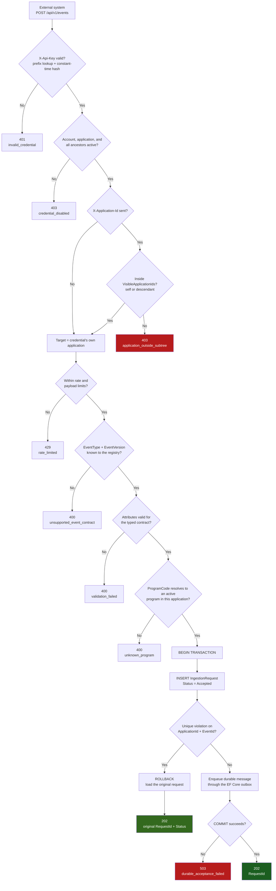
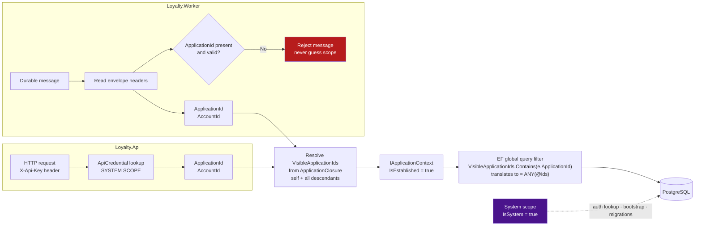
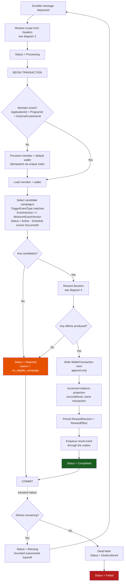
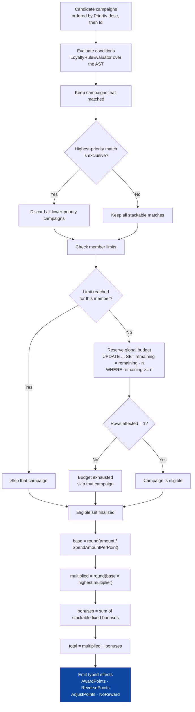
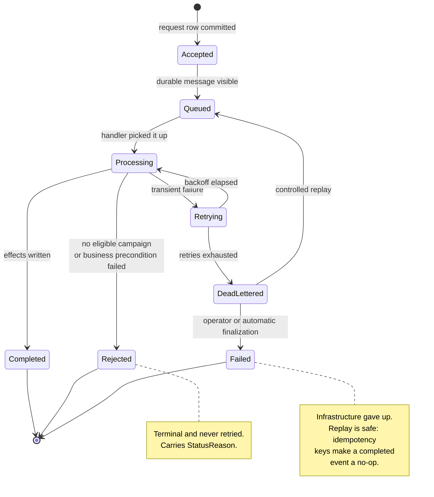
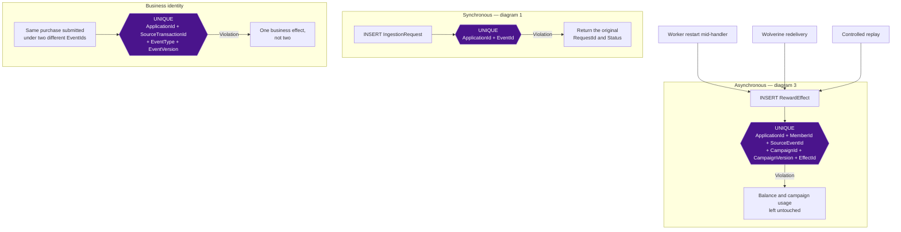

# Processing Flow

Detailed flowcharts for the MVP described in [`../MVP_IMPLEMENTATION_PLAN.md`](../MVP_IMPLEMENTATION_PLAN.md). Section references below point into that document.

- [1. Synchronous ingestion](#1-synchronous-ingestion)
- [2. Scope establishment](#2-scope-establishment)
- [3. Asynchronous processing](#3-asynchronous-processing)
- [4. Reward decision](#4-reward-decision)
- [5. Request status lifecycle](#5-request-status-lifecycle)
- [6. Idempotency checkpoints](#6-idempotency-checkpoints)

---

## 1. Synchronous ingestion

`POST /api/v1/events` in `Loyalty.Api`. Everything here must be fast and must commit the request row and the durable message together (§8, §16).



Two headers, with distinct jobs:

```http
X-Api-Key:        lp_live_7f3c…      required — authenticates the account
X-Application-Id: acme-baghdad       optional — which application owns the event
```

`X-Application-Id` is the explicit-request channel §7 requires for a parent writing on a descendant's behalf. Absent, or equal to the credential's own application, owns the event locally. A descendant is accepted and owns the event, member, wallet, and ledger rows. A parent, sibling, unrelated, or nonexistent ID returns `403`. The header may only point *down* the tree, tested against the same `VisibleApplicationIds` set that backs the query filter — so write authorization is exactly read authorization.

`AccountId` and `SourceSystem` always come from the credential and can never be overridden, whichever application is targeted.

Notes:

- The duplicate branch returns `202` with the original `RequestId`, not a `409`. A retrying caller should not be able to tell a first submission from a replay — that is the point of §9.
- Nothing is validated *after* the transaction opens. Every rejection is decided before the first write, so a rejected event never occupies a request row.
- `ProgramCode` is resolved against the **target** application — the one `X-Application-Id` names, or the credential's own when the header is absent.

---

## 2. Scope establishment

Both entry points converge on one `IApplicationContext`, so a query behaves identically in the API and in the worker (§7).



The dashed path is the only filter bypass in the system. It is named, gated on `IsSystem`, limited to three call sites, and covered by architecture tests. `IgnoreQueryFilters` and raw SQL on scoped entities fail the build everywhere else (§7).

---

## 3. Asynchronous processing

One Wolverine handler, one database transaction (§16).



Notes:

- `Rejected` is a business outcome and is **not** retried. Only transient infrastructure failures re-enter the loop (§16).
- Request state, campaign usage, ledger, projection, and the outbox event all commit or all roll back. There is no window where the ledger has moved but the outbox has not.
- A retry re-runs the whole handler. Duplicate effects are prevented by the effect-level unique index (diagram 6), not by handler bookkeeping.

---

## 4. Reward decision

Pure computation over loaded state (§11, §12). No writes happen inside this box — it returns a set of typed effects that diagram 3 persists.



The multiplier applies to the **base only**; bonuses are added afterwards and are never multiplied. Rounding uses the program's `RoundingPolicy` at both steps. The §11 reference case — `149.50` at `1.00` per point, `×1.5`, `+50` bonus, `Floor` — must yield exactly `273`.

Budget reservation is the one impure step: it is an atomic conditional `UPDATE` rather than read-modify-write, because optimistic concurrency on a hot campaign budget produces retry storms. It runs inside diagram 3's transaction, so a later rollback releases it.

---

## 5. Request status lifecycle

The statuses of §8, and which transitions are legal.



---

## 6. Idempotency checkpoints

The three unique indexes of §9, and where each one fires.



Every check is a database constraint. None is a `SELECT` followed by an `INSERT` — that pattern races between two concurrent identical retries, which is precisely the case idempotency exists to handle.

`CampaignVersion` is part of the effect key so that an edited campaign cannot collide with decisions produced by its own earlier version.

`ApplicationId` leads every key. Two applications may reuse the same `SourceTransactionId` without interfering.
